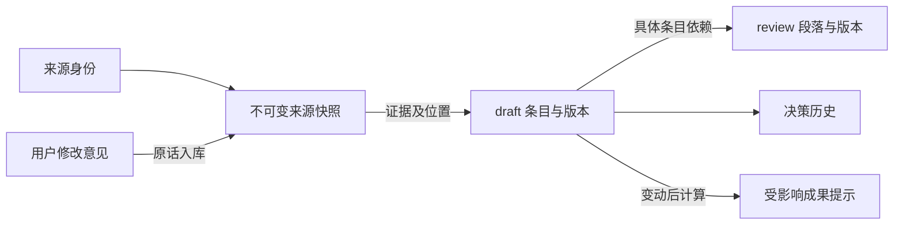

# Yu+ 数据库与 CLI 详细契约

实现对照稿 v0.2 · 2026-10-13 · 承接已认可的本地存储方案

本文将对象关系落成表结构、输入输出及校验契约。创建项目、来源收录、draft 修改、review 准备与发布以及部分查询已实现，使用方式见[仓库说明](../../../README.md)。其余辅助命令和后台集成仍为设计；前端风格不在本轮范围。

配套文件：

- [数据库 DDL](contracts/v0.1/schema.sql)：13 张业务表、索引、外键和不可变约束。
- [核心命令输入 Schema](contracts/v0.1/cli-input.schema.json)：source.import、draft.apply、review.prepare、review.publish。
- [输出信封 Schema](contracts/v0.1/cli-output.schema.json)：统一成功与错误结构。
- [对象属性目录](contracts/v0.1/object-types.json)：23 类业务对象的含义、可能来源、展示、下游关系和字段定义入口；未来 Skill 与 CLI 共用此目录。
- [输入输出实例](contracts/v0.1/examples/)与[契约验证程序](contracts/v0.1/verify_contracts.py)。

## 1. 总体约定

一个数据目录内，一份 SQLite 库管理多个项目，原文件进入本地按 SHA-256 寻址的文件池。所有业务查询和写入显式传 `--project`；不依赖前端当前打开的项目，避免 Agent 把两个对话的材料混在一起。文件字节可以跨项目去重，项目内的来源身份、采用口径、历史不能混用。

业务对象按需建立：每项目每类 draft 一个聚合对象，内部条目有稳定 `item_id`。23 类业务对象不需要建立 23 套表，不预填空对象，也没有必须填完才能整理的门槛。review 有四种持久化成果；R05 Q&A 直接读取 D15。



不把 Agent 的读取过程存成状态。`sealed` 仅是数据库同一个事务内封存版本的内部标记，不向用户展示。前端可展示真实的“远端有更新”“依据已变”“待复核”，这些来自已保存记录之间的比较。

## 2. 数据库表与字段责任

完整字段、SQL 类型、默认值和外键以 DDL 为准；以下说明业务含义。

| 表 | 主键及重要字段 | 保存什么／允许怎么变 |
|---|---|---|
| `projects` | `id`；name、working_scene、lifecycle、metadata_version | 项目名称、当前浏览场景、归档状态；元信息版本做并发校验。场景随时切换，无准入条件 |
| `changes` | 全库递增 `seq`；唯一 id；project_id＋request_id 唯一 | 命令、请求哈希、执行者、理由、因果变更、变动位置、结果回执；只追加。不是决策正文，也不保存聊天全过程 |
| `sources` | project_id＋id；provider＋resource_type＋provider_key 在项目内唯一 | 来源身份、标题缓存、规范链接、本地主快照、远端检测结果；可更新元信息，不改身份 |
| `source_versions` | project_id＋id；source_id＋version 唯一 | 原文/提取文本、远端 revision、获取范围、提取方式、内容哈希和来源归属；封存后不可变 |
| `blobs` | sha256 | 文件大小及内容寻址路径；一份物理字节可被多次引用 |
| `source_files` | project_id＋source_version_id＋asset_id | 某次快照里的原件、附件、预览等；原名称和 MIME 在这里。二选一保存本地副本哈希，或外部路径＋当时哈希＋大小 |
| `objects` | project_id＋id；layer＋type_key＋scope_key 在项目内唯一 | draft/review 稳定身份与当前版本指针；标题不充当身份 |
| `object_revisions` | project_id＋id；object_id＋version 唯一 | 完整内容快照、内容哈希、变更 ID；review 额外保存段落因果履历 block_lineage_json |
| `revision_sources` | revision_id＋item_id＋evidence_id，均带 project_id | draft 条目采用的来源快照、附件及引用位置；review 通过 draft 追溯原件 |
| `revision_dependencies` | consumer_revision_id＋consumer_item_id＋dependency_id，均带 project_id | 消费方段落/条目依赖的 draft 对象、具体版本、条目和指纹；支持 draft 间推导及 draft → review |
| `decisions` | project_id＋id | 决定内容、谁决定、指令来源、理由、受影响版本/条目、替代哪条旧决定；只追加 |
| `review_checks` | project_id＋id | 对具体 review 版本和段落的接受、修改意见或知悉记录；旧接受记录不迁移到新版本 |
| `exports` | project_id＋id | 哪个 review 版本（或 R05 的 D15 版本集合）导出到哪个来源身份/文件；不是第二套项目内容 |

所有时间由程序以 UTC RFC3339 写入；材料自带时间另外保留。`captured_at` 是材料获取时间，`recorded_at` 是实际入库时间，二者不能混同。IDs 由 CLI 生成，不以名称、文件路径或数组序号推导。

### 2.1 版本正文与关系表

draft 的 `payload_json` 固定为 `{title, items: [{item_id, data, epistemic_kind}], item_order}`；review 固定为 `{title, blocks: [{block_id, markdown}], block_order}`。数组和 order 中的 ID 一一对应，关系另存表中。读取命令把它们组装回带 `source_refs`/`dependencies` 的完整响应，不要求 Agent 自己查询多张表。

`epistemic_kind` 区分原文陈述、用户补充、转述、假设、建议、采用决定。未知字段可以不存在，不用空字符串或虚构数值占位。对象可以仅有一个已知字段。

`content_hash` 由 CLI 计算，覆盖正文及规范化后的证据/依赖，排除 ID、版本号和写入时间；不是 Agent 可填的字段。关系虽分表保存，仍属于同一不可变版本。改证据也会形成新版本。

### 2.2 类型和范围

- 普通 draft：`scope_key=project`。内部 `expression_guide`：`scope_key=review:<review_object_id>`，每条要求限定段落 ID 或 `*`。
- review：默认 `scope_key=project`；创作者 Brief 使用 `creator:<D19资源条目ID>:round:<轮次ID>`。同类同范围只有一个稳定身份。
- 初次成果不需要表达指南。用户要求改既有成果措辞时，已有 review 身份可供指南绑定。
- 其他 review 如需多个轮次，使用 `round:<轮次ID>`；轮次引用同项目 D18 交付条目中的 round_key。CLI 校验范围所指实体存在，不允许随意变造范围来规避既有成果更新规则。
- R05 不出现在可发布类型枚举中，查询时返回 D15 的真实 object/revision/item ID。

### 2.3 SQLite 和领域校验的分工

| SQLite 直接保证 | CLI 领域逻辑保证 |
|---|---|
| 项目内复合外键、同类同范围唯一、顺序版本号、历史禁止 UPDATE/DELETE | JSON 内的条目存在、类型字段、金额日期约束、跨条目引用、依赖无环 |
| 主指针只指向本对象已封存版本，不能倒退 | 比较调用者的 base_revision，避免读旧写新；归档项目禁止普通写入 |
| 原文、证据、依赖一旦封存不能追加或改写 | 本次事务离开前所有新版本已封存、关系完整、内容哈希正确 |
| 依赖生产方只能是同项目已封存 draft；review 不能反过来成为事实生产方 | review 更新必须有相关且尚未体现在该段落的 draft 变更；受影响成果不能冒充已同步 |
| request_id 唯一、回执只追加 | 同键同请求返回旧结果、同键异请求拒绝；没有业务变化时不造新版本 |

SQLite 无法验证 Agent 的自然语言是否正确理解预算、是否漏引了材料，CLI 也不能仅凭引用判断文意完全正确。硬约束保证有据可查的更新路径；分析正确性由 Skill、差异展示和人的检查保障。不能宣传成“数据库保证语义正确”。

## 3. CLI 通用输入输出

```sh
yu source import --project prj_city --request-id req_source_01 --input source.json --json
yu draft apply --project prj_city --request-id req_budget_02 --input draft.json --json
yu review prepare --project prj_city --input prepare.json --json
yu review publish --project prj_city --request-id req_review_02 --input review.json --json
```

`--input -` 从 stdin 读取 UTF-8 JSON；大文本也可以先写成本地文件再用附件导入。JSON 内 `command` 必须匹配命令路径；`api_version` 固定 `"1"`。写命令必须有 request-id，读取命令不需要。`--json` 下 stdout 只有一个 JSON 对象，诊断走 stderr，进程退出码表明成功或失败。此模式不得出现交互提示。

输入的项目只来自 `--project`，不能在嵌套对象里覆盖。默认单次 JSON 上限 8 MiB、单个 draft 批次最多 100 个对象操作/1,000 个条目变动；原文件不计入 JSON 限额，文件以流式复制处理。达到限额返回可操作错误，不截断。

成功信封：

```json
{
  "api_version": "1", "command": "draft.apply", "ok": true,
  "project_id": "prj_city", "request_id": "req_budget_02",
  "data": {
    "effect": "changed",
    "objects": [{"object_id": "obj_budget", "revision_id": "rev_budget_2", "version": 2}],
    "decisions": [{"decision_id": "dec_budget_60"}],
    "affected_reviews": [{"object_id": "obj_debrief", "block_ids": ["budget"], "reason": "dependency_changed"}]
  },
  "meta": {"change_id": "chg_budget_02", "history_cursor": 12, "replayed": false}
}
```

错误信封：

```json
{
  "api_version": "1", "command": "review.publish", "ok": false,
  "project_id": "prj_city", "request_id": "req_review_02",
  "error": {
    "code": "DRAFT_BASIS_CHANGED", "message": "预算依据已更新，请重新读取后生成成果。",
    "retryable": true,
    "details": [{"path": "/documents/0/read_basis/0", "object_id": "obj_budget", "expected": "rev_budget_2", "actual": "rev_budget_3"}],
    "next_action": "重新运行 review.prepare，基于新依据生成输入，并使用新的 request-id。"
  },
  "meta": {"change_id": null, "history_cursor": 15, "replayed": false}
}
```

`retryable` 表示修复/刷新后可以重试，不表示原请求必然能直接重试。不存在或无法解析项目时 project_id/cursor 可以为 null。error.details 是供机器定位的结构，不需要从中文消息提取 ID。错误不产生业务 change；读命令 change_id/request_id 为 null。prepare 的结果是瞬时读取，不形成长锁或预约。

### 3.1 幂等和并发

1. 完成 JSON 解析与基础校验后，先按 project_id＋request_id 查回执，早于版本比较和文件重读。
2. 相同 request_hash 返回原 `data`、原 change_id/cursor，`replayed=true`，即使当前项目后来发生变化。响应应明确这是旧提交回执，不能当当前状态。
3. 同 request-id 不同请求返回 `IDEMPOTENCY_CONFLICT`。哈希包含 API 版本、命令、项目和完整输入，JSON 对象键排序、数组顺序保留、字符串原样、拒绝重复键/NaN/Infinity；不包含 request-id、运行时间和进程信息。
4. 因输入中的文件路径也属于原请求，重放不重新导入已变化的文件；需要新内容时用新 request-id。建议提供 expected_sha256 防止“计划导入时”和实际导入时文件已变化。
5. 一次真正没有变化的提交也保存 `effect=noop` 回执，但不生成来源/对象新版本，不生成虚假决策。正常业务历史默认过滤 noop。
6. 每个已存在对象必须传确切 base_revision；新对象传 null，已有身份却传 null 返回冲突。所有检查在 `BEGIN IMMEDIATE` 后重验，不能只依赖事务前读取。

## 4. 来源收录：`source.import`

### 输入

`target` 选择 create（provider、resource_type、可选 provider_key/URL）或 append（source_id、base_snapshot_id）。snapshot 包含 title、provider_revision（未知为 null）、captured_at、capture_scope、extraction_profile、provenance；至少有 body 或一个 asset。advance_head 明确是否更新本地主快照。

三种入口共用命令，读取材料的工具不内置进 Yu+：

| 材料 | Agent 提供给 CLI | 保存结果 |
|---|---|---|
| 飞书文档 | 飞书 CLI 实际读出的文本/导出文件、文档身份和实际 revision（可获取时） | 飞书来源身份、标题/链接、不可变本地快照；将来检查可独立发现远端变化 |
| 本地文件 | 路径、文件角色和 MIME，可同时附提取正文 | 默认复制原件到文件池；PDF 页码、图片说明、视频时间点通过 locator 关联 |
| 用户口述 | 用户原话或明确标注为转述的文本、reported_by | oral 来源与原话快照；Agent 的分析进入 draft，不替换原话 |

具体 JSON 见 examples/01、02、03。示例中的 Feishu 地址和路径为占位，不会访问真实客户材料。

### 校验与落库

1. 远端资源按 provider/resource_type/provider_key 识别，不按标题或带分享参数的完整 URL；飞书 wiki 节点先解析实际资源，保留原链接作为材料说明。provider_key 应由已安装适配器规范化，不能以任意分享链接充数。
2. create 遇到相同远端身份返回 `SOURCE_EXISTS`，附已有 source_id/head，Agent 改用 append。本地完全相同文件返回重复候选，不静默混合两个来源身份；明确复用已有来源或提供明确的新来源身份后再收录。底层字节照常去重。
3. append 必须比较 base_snapshot_id 与当前 head；selection 捕获也做比较，避免把旧口径误当最新。
4. `capture_scope=selection` 可以入库和被引用，但 advance_head 必须为 false。节选不能替代整个材料的主快照。这是记录范围，不是判断 Agent“部分读取”的状态。材料整体是一个文件时，即便只提取其中部分文字，也应在提取方式/locator 中说明，不能把节选正文标成完整提取。
5. copy 将文件流式复制到 staging，校验哈希/大小，再原子发布到文件池。external 是明确选择只登记原位置，保存当时路径/哈希/大小；将来文件变化或丢失不能把新字节当旧证据，界面提示该历史原件不可用。通常优先 copy。
6. 相同来源、provider_revision、范围、提取方式以及内容均相同，返回已有 snapshot，effect=noop（若标题缓存改变则 effect=changed 但 snapshot 仍复用）。不同捕获时间不制造版本。没有 provider_revision 时按当前相同范围/提取方式快照比内容。
7. 相同明确 provider_revision＋范围＋提取方式却读出不同内容，拒绝 `SOURCE_REVISION_CONFLICT`；如果确实更换了解析方式，用不同 extraction_profile 留下新快照。未知 revision 不伪造为云端版本号。
8. 新远端 revision 即使正文没变，也记录新快照以保留版本对应关系；重新采用历史内容创建新快照，不倒退 head。纯远端标题变化可以更新 cached_title，不改历史 title_at_capture。
9. 在一个短事务写 source/source_version、files、封存、head、change 回执。任何失败都不留下可见半份来源；事先发布但未引用的文件可成为孤立文件，由之后 GC 清理。

复用旧 snapshot 时不能倒退 head：若命中已有但非当前的快照，advance_head=false 可以只返回该历史引用；advance_head=true 返回 SOURCE_REVISION_OUTDATED，并提示重新检查远端。远端在新 revision 恢复了旧内容时，仍按新 revision 收录。CLI 不对任意远端 revision 字符串做大小比较。

content_hash 覆盖获取范围、提取方式、原样正文及有序附件清单（asset_id、role、MIME、文件哈希、locator），排除机器上的路径、获取时间和标题。路径变化不算材料内容变化。资产哈希以实际字节为准；JSON 结构采用第 3.1 节的规范化规则。

实现补充：材料内容与本地保存方式分别比较。外部路径改为本地复制、外部原件位置或附件展示名称改变时，追加本地快照保存新的附件清单；内容 hash 和远端 revision 可以相同。旧快照不被修改，不能把用户要求复制的请求静默当成仍然只引用外部路径。复制模式下仅导入路径改变而字节与附件说明不变，仍可复用。飞书 doc/docs、sheet/sheets、bitable/base 别名在身份查询和保存前统一规范化。

### 输出 data

`effect`、`source_id`、`snapshot_id`、`snapshot_version`、`head_snapshot_id`、`snapshot_reused`、`title`、`canonical_url`、`assets[{asset_id,sha256,size_bytes,storage}]`、`dependent_draft_items[{object_id,item_id,adopted_source_version_id}]`。source.import 不修改 draft，也不把旧证据引用自动改指新快照。

### 远端检查与当前采用版本

后台启动检查只更新 sources.remote_observation_json、generation、last_checked_at、check_error，不在后台整理正文。检测字段包括 provider_revision/modified_time、检测方法、checked_at；只有版本号或内容比较足够可靠时显示“有更新”，否则显示“可能变化/无法确认”。网络或权限失败不能清除已有更新提示，必须保留最后成功观察。

一次检查开始时记住 generation，结束写入时 compare-and-swap；过期检测结果不覆盖新的结果。快照提交也比较它和最近已知远端 revision，不能因为下载成功就清掉更新提示。每个 draft 条目仍保有自己的 adopted 来源快照；同一材料可能只有部分内容需要更新。

## 5. draft 修改：`draft.apply`

### 输入

reason、可选 instruction_source_version_id、objects 操作数组、decisions 数组。每个操作包含 op_id、type_key、scope_key、base_revision，已存在时携带 object_id；title/set_items/remove_items/item_order 至少一种。

- set_items 是**指定条目的完整替换**：data、epistemic_kind、source_refs、dependencies 都需提交。未列出的兄弟条目保留。
- remove_items 明确删除当前条目，旧版本仍在；null 不代表删除。删除被依赖条目会返回影响范围，不能伪装成无影响。
- item_order 如提供，必须是修改后全部条目 ID 的完整排列；不提供时保留旧顺序，新条目按输入追加。
- 同一个对象在批次内只出现一次；item_id、evidence_id、dependency_id 在对应范围内唯一；set/remove 不可相交。object_id 与 type/scope 必须一致。
- dependencies 可指已有 draft 版本，也可用 op_id 引用本批次将生成的条目，CLI 拓扑排序后写入；循环引用报错。

### 类型校验

23 类的 data 字段已分别定义于输入 Schema，并非任意 JSON。字段可以缺失；禁止的是格式或引用矛盾，不是资料不足。

| 示例 | 校验 |
|---|---|
| D07 预算 | 金额使用最小货币单位的十进制整数字符串；提供金额时需 currency；min≤max。100 万人民币为 `100000000` 分，60 万为 `60000000` 分；不接受浮点金额 |
| D09 节点 | 只有 event 也可保存；提供时间需 time_kind；date 为有效日期，instant 必须有时区偏移，range 两端同类且 start≤end |
| D18 交付 / D20 职责 | resource_item_id 若出现，须引用同项目 D19 已有条目；不能借用客户决策角色 D10 |
| D15 Q&A | 可以只有 question，不必有 answer；related_object_ids 引用同项目真实对象，问题状态是业务事实而非启动门槛 |
| 内部编写要求 | 必须绑定既有 review 及合法 block_ids 或 *，附用户指令来源；不能生成无目标的“允许随意重写”通行证 |

### 来源、依赖与决定

原文陈述、用户补充、转述至少有一个来源引用，hypothesis/suggestion 可没有，但性质不可冒充事实。adopted_decision 必须由本批次 decisions 覆盖，并指向可追溯的用户指令/决定来源。已有 adopted_decision 条目改任何内容，应重新记录决定；不变条目可保留原来的决策关联。

引用必须同项目且是封存快照，asset_id 必须属于该快照，locator 的结构须可解释（如 block_id、页码、时间范围、原文引用）；未知位置允许 `{}`，不编造定位。被删除/过时的依赖不允许悄悄升级到新版本；需要 Agent 重新读或明确保留旧口径及原因。

decisions 保存 statement、decided_by、instruction_source_version_id、rationale、affected_items；CLI 将 op_id 解析成实际 object/revision/item。更改已有决定，新增记录并 supersedes_id 指向旧记录；旧正文不可覆盖。同一旧决定最多有一个直接后继，后续修改沿链追加。CLI 能核对引用存在，不能证明“某个人说了这句话”的真实性，Agent 必须据实际对话/材料署名。

### 事务与输出

事务内重新比较所有 base_revision，验证来源、跨对象字段及最终依赖图，计算实际差异。无变化操作返回 reused 版本；有变化操作追加完整版本，写证据和依赖、封存、推进 head，追加决定及 change。

多对象批次全成或全败。新来源先独立收录，因此 draft 失败时仍保留合法的来源快照。输出包括每个 op_id 对应的 object/revision/version/changed、decision IDs、affected_reviews 及 affected_draft_items。后一项用于提醒派生的 draft 也可能需要重算。

影响是通过条目级指纹和反向关系计算的，不是把整项目 review 一律标黄。无关的品牌素材变化不影响只依赖预算的段落。传递依赖也必须检查，例如预算 → 分配建议 → 创作者 Brief。

## 6. review 生成与更新

### 6.1 `review.prepare`：获取可写依据

输入 target、cause_change_ids、select_basis（对象＋条目选择）。CLI 在一致的只读快照中返回：

- target 的 object_id、current_revision_id、当前正文和段落因果履历摘要；首次则为空。
- draft read_basis 和所选条目，连同来源链接、位置、指纹。
- 既有成果受影响的段落、已删除依据、可用的相关 draft changes。
- 已记录的表达要求；旧确认记录对应哪些旧版本。

已有成果会自动包括其依赖及相关表达指南；select_basis 可补充新内容。初次生成至少选择一项实际 draft 依据，不能让工具凭空制造完整成果。缺资料照样可以生成简短成果，不要求齐全，也不会补造未提供的事实。

prepare 不调用模型，不替 Agent 写正文，也不持有写锁。之后由 Agent 按 Skill 编写完整段落，提交 publish。prepare 的输入不是可写凭证，publish 必须再次校验当前版本。

### 6.2 `review.publish`：以段落变更提交，保存完整成果

输入 reason、documents[]；每份成果包含 target、base_revision、read_basis、structure_cause_change_ids 和 set_blocks/remove_blocks/block_order/title。

set_blocks 每项包含 block_id、markdown、dependencies（至少一项）、cause_change_ids。未列出的段落保留。数据库最终存的是重组后的完整成果，不是孤立补丁。每份成果至少保留一个段落；空成果直接归档，不用生成空版本。

初次生成可以 cause_change_ids 为空，但每段必须引用当前有效 draft。更新既有成果时，以下规则不可省略：

1. **内容、证据变化先发生于 draft。** source.import 的 change 不可直接作为 review 修改原因；理由文字或用户口头要求也不能代替 draft 版本。
2. 每个被改写/新增的段落，必须有相关 draft change。该 change 的变动位置应与段落新旧依赖交集，或是明确指向本成果/段落的 expression_guide。删除段落、改标题、排序也需要相关 draft 依据；纯结构变更使用指南。
3. 相关并不等于可反复使用。CLI 对照旧段落的依赖版本及因果履历，拒绝已经体现在该段落中的旧原因。首次生成时的依据也计入已采用历史，不允许拿其创建 change 作为后续任意重写理由。
4. 使用**每段履历**，不使用一个全成果“最后修改时间”门槛。同一预算 change 可以分别更新预算段和交付段，或多个相关成果；但同一段不能反复消费。删除段落也保留 tombstone 履历；复用其 ID 时同样检查。
5. read_basis 必须覆盖本次生成读取的 draft 版本；提交时该清单中的版本已变则拒绝。未修改段落可以保留旧版本引用，但只有在其选择条目的指纹仍与当前一致时才允许。
6. 不能发布包含已失效依据的当前成果：本次目标中仍受影响的段落必须更新、重新绑定有效依据或有据删除。其他独立成果可以暂时保留“依据已变”，不要求全项目同时完成。
7. 自然语言含义相同但来源换版时，可只重新绑定证据依赖并生成新 review 版本；仍需相应 draft change。该操作不自动代表用户复核通过。

`block_lineage_json` 由 CLI 从旧履历推导，记录段落最后编写版本、采用的依据及已应用因果 IDs，连同删除记录；Agent 不可提交这个字段。结构修改另有文档级履历键。最小实现可保留全部因果 IDs，规模增大后再考虑压缩，不能丢失判断所需信息。

### 6.3 指纹与传递失效

指纹由 CLI 计算，不信任 Agent 声称“未受影响”。条目指纹覆盖 data、信息性质、来源版本和定位、依赖的选择器及指纹；排除纯时间戳、承载它的对象版本号和缓存标题。选 `*` 时覆盖整个对象正文、条目、排序及关系，所以整对象依赖更容易受影响。优先引用具体条目。

当前 draft 派生条目自身依赖已失效时，即使其文字未改，review 也不能以它作为“当前有效”依据发布；先更新上游派生条目或选用仍有效依据。这使预算改变能沿实际关系传到成果，同时保留中间状态供查看。

### 输出与失败恢复

输出每份成果的 object_id、revision_id、version、updated_blocks、removed_blocks、basis，以及 requires_recheck_blocks。旧 review_checks 永远保留在旧版本上，新版本不继承 accepted；未改段落可展示“原版本曾确认”，不能标成整份新版本已确认。

所有 documents 在一个短事务中检查并写入，全成或全败。如果 draft 已提交而 review 失败，draft 保留，review 保持旧版且显示受影响；Agent 重跑 prepare 后继续。禁止为了“同步失败”回滚或篡改已提交的事实历史。

## 7. 一条完整例子：预算 100 万 → 60 万

examples/01 至 09 是一条固定 ID 的说明性序列，CLI 实际生成 IDs，Agent 应接着使用真实输出。

1. 收录飞书需求材料，保存“预算 100 万”原文快照 sv_brief_1。
2. `draft.apply` 建立 D07 的 client_budget 条目，来源为该快照；其他 22 类不必存在。
3. prepare → publish，形成一份简短 Debrief，预算段依赖 rev_budget_1/client_budget。
4. 用户在 review 对话中说“现在按 60 万推进”。原话作为 oral 快照 sv_instruction_1 收录，原飞书材料保持原样。
5. `draft.apply` 把同一个预算条目改为当前采用 60 万，保留旧客户说法的来源并以 instruction/contradicts 等关系说明差异，追加正式决定。
6. 输出预算段受影响。prepare 返回新的 draft 依据和旧成果；Agent 将预算段改写，publish 引用 chg_budget_02。
7. 如果第 6 步前预算又改成 50 万，publish 返回 DRAFT_BASIS_CHANGED；不出现“新预算配旧成果却标成同步”的情况。

如果用户只是说“预算这一段简短一点”，第 5 步改的是 expression_guide；D07 数值保持原口径，后续预算段依据该指南改写。无论业务还是表达，先因后果都走同一条结构。

## 8. 辅助命令边界

本轮机器可校验输入集中在四个核心命令。其余命令的接口责任如下，正式实现时补齐各自 JSON Schema，不将本表宣称为完整实现。

| 命令 | 输入要点 | 输出要点 |
|---|---|---|
| `project create/list/show/update/archive` | 名称；写入的 request-id；更新时 metadata_version | 项目 ID、场景、元信息版本、归档状态；create 是无 project 参数的例外 |
| `source list/show/history/diff` | 项目、来源/快照、分页或两个版本 | 来源身份、原件、正文、版本差异、采用位置；show 默认不塞全量大正文 |
| `source check` | 项目或启动时明确 --all-projects | 每来源检查依据、观察结果、权限/网络错误；不改业务对象 |
| `draft list/show/history/diff` | 项目、type/object/revision、可选 items | 当前或历史内容及证据；可按条目裁剪读取 |
| `review list/show` | 项目、type/scope/object，可指定旧版本 | 完整成果、每段依赖/来源链、依据变化和旧确认记录 |
| `review check` | 精确 revision、block IDs、verdict、用户意见快照 | 追加检查记录；changes_requested 只记录意见，不直接改成果 |
| `object archive` | project、object、base_revision、reason | 隐藏当前身份、返回依赖影响；不删除历史、不重用身份绕开更新 |
| `relations show` | object/item、方向、深度、版本 | 当前或历史上游/下游；默认一层，按需展开 |
| `changes list/show`、`decisions list/show` | 项目、after_cursor、object/type 筛选 | 增量历史及具体决策理由；默认不返回全项目时间线 |
| `project context` | 项目、可选 since_cursor、scene | 少量当前状态、最近有关变化与未解决问题；供新会话按需恢复 |
| `types show` | type_key、可选 scene | 本文属性目录与字段规则，不需要 Agent 每轮读取全部类型 |
| `doctor` | 可选 --feishu | 数据目录/SQLite/CLI 版本、飞书 CLI 可用性与登录/读取能力；不输出凭证 |

分页默认 50、最大 200，返回 next_cursor/has_more；游标绑定项目及过滤条件，不能跨查询混用。查询类返回读取时 history_cursor，Agent 可据此请求增量。Skill 指导按需读，不能要求每轮重新加载完整项目和全历史。

## 9. 校验顺序、错误码与事务

统一顺序：解析与 Schema → 幂等回执 → 项目/身份/归档检查 → 文件预备及摘要 → 开始写事务 → 重查幂等和 base → 关系/字段/因果校验 → 追加版本/关系 → 封存/推进指针 → change 回执 → commit。

changes 在最终结果准备好后插入，版本引用它的外键延迟到 commit 检查，避免修改只追加回执。result_json 保存 data；返回的 meta 从 changes 行的 id/seq 组装。事务中禁止模型调用、联网下载或长文件复制。读命令走只读事务。

写连接必须开启 foreign_keys 与 recursive_triggers；正式写路径禁用 INSERT OR REPLACE，避免替换行破坏历史语义。source/object 版本只允许插入，随后仅执行一次 sealed=1 的封存动作。数据库迁移走独立、显式的维护入口。

| 退出码 | 代表错误码 | Agent 的恢复动作 |
|---|---|---|
| 0 | 成功、noop、幂等重放 | 依据 effect/replayed 判断实际新变化 |
| 2 | INVALID_INPUT、UNKNOWN_FIELD、INPUT_TOO_LARGE | 按 details.path 修正参数 |
| 3 | PROJECT_NOT_FOUND、OBJECT_NOT_FOUND、SOURCE_NOT_FOUND | 核实项目/身份；不自动在另一项目寻找并改写 |
| 4 | BASE_REVISION_CONFLICT、DRAFT_BASIS_CHANGED、IDEMPOTENCY_CONFLICT、SOURCE_EXISTS、SOURCE_DUPLICATE、SOURCE_REVISION_CONFLICT、SOURCE_REVISION_OUTDATED | 查看当前值/重复候选，重新组织请求；修改输入后用新 request-id |
| 5 | CROSS_PROJECT_REFERENCE、PROJECT_ARCHIVED、INVALID_SCOPE、INVALID_ITEM_REFERENCE、DEPENDENCY_CYCLE、INVALID_MONEY、INVALID_TIME、SOURCE_EVIDENCE_REQUIRED、DECISION_REQUIRED、DRAFT_CHANGE_REQUIRED、CAUSE_ALREADY_APPLIED、STALE_DEPENDENCY、PARTIAL_CAPTURE_CANNOT_ADVANCE_HEAD | 修复语义关系或先完成上游修改；不通过删除历史绕开 |
| 6 | FEISHU_UNAVAILABLE、SOURCE_CHECK_UNSUPPORTED | 保留已有记录，修复外部能力；不能伪造已检查 |
| 7 | FILE_NOT_FOUND、FILE_HASH_MISMATCH、IO_FAILURE、DISK_FULL | 修复文件/磁盘，再安全重试；无数据库部分提交 |
| 8 | DATABASE_BUSY | 短暂退避重试相同请求；等待上限后报告忙碌 |
| 70 | INTERNAL_ERROR、INTEGRITY_FAILURE | 保留诊断 ID，不自动破坏或重建业务数据 |

原子性止于本地 SQLite 事务。对象池发布在事务前，失败可能留下未引用的字节，但不会产生引用缺失文件的已提交记录。GC 与备份采用独占维护锁，导入器持共享维护锁至提交，防止新发布文件被并发 GC 删除。外部 Feishu 导出不与 SQLite 宣称分布式原子性，须有独立导出恢复设计。

## 10. 验证范围与后续实现验收

配套验证程序检查 Schema 自身、说明性 JSON 实例及 DDL 的正反用例；只用内存数据库，不生成正式项目库。它不执行真实 CLI，也没有代替业务语义实现。

本轮实际验证：94 项检查通过，SQLite 3.53.4。覆盖 Schema/实例格式、23 类属性目录引用、合法来源→draft→review 入库，以及跨项目引用、篡改历史、追加旧版本关系、覆盖回执、重复身份、版本倒退等拒绝用例。日期格式验证依赖已显式安装，且有非法日期反例检查。

最小链路实现已通过 86 项运行测试，覆盖请求重放、重复材料、旧 base、因果重复消费、表达指南、传递失效、多项目隔离和无变化不造版本；安装后的 CLI 演示也已通过。文件保存失败后的重试已验证，真实异常断电恢复、外部集成、完整复核记录命令及跨机器分发仍需后续验收。

SQLite 外键依赖每个连接开启 foreign_keys；DDL 中的 STRICT 表约束存储类型，JSON 内部字段仍由 CLI 校验。参考：[SQLite 外键](https://www.sqlite.org/foreignkeys.html)、[STRICT 表](https://www.sqlite.org/stricttables.html)、[触发器](https://www.sqlite.org/lang_createtrigger.html)。输入使用 [JSON Schema Draft 2020-12](https://json-schema.org/draft/2020-12/json-schema-core)。


### 已实现补充：project.rename（v0.3.5）

CLI：`project rename --project ID --name NAME --base-version N --request-id REQUEST_ID --json`。使用 `project show` 返回的 `metadata_version` 作为 N，不接受 JSON `--input`。名称去除首尾空白后不能为空，N 必须是正整数。项目必须存在且未归档。

领域输入：`{name: string, base_metadata_version: integer}`。返回 data：`{effect: changed|noop, project_id, previous_name, name, metadata_version, working_scene, lifecycle}`；标准 meta 提供变更 ID、历史游标和幂等重放标记。

在单个写事务内核对元信息版本，变化时更新名称、updated_at 并将 metadata_version 加一；记录新旧名称。相同名称返回 noop，不改项目时间和版本。旧版本返回 `BASE_REVISION_CONFLICT`（退出码 4），请求 ID 改参数返回 `IDEMPOTENCY_CONFLICT`，失败不写历史。同参数重试返回原回执，不回滚后续改名。项目 ID 和所有业务关系保持不变，现有只读 `/api/view` 在下一次读取时返回新名称，无需新增 HTTP 写接口或数据库迁移。
