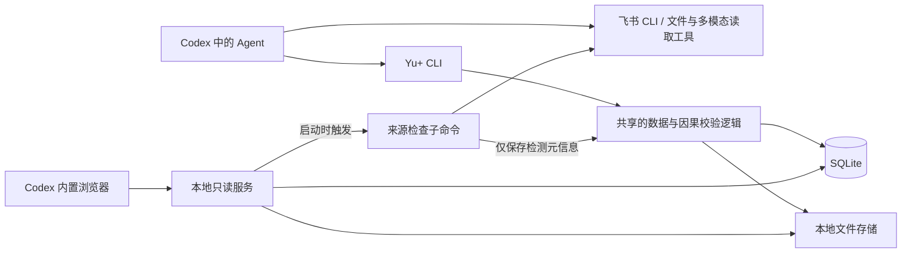

# Yu+ 本地数据库、对象存储与 CLI 设计

整体方案已认可 v0.2 · 2026-10-13

数据库字段与核心命令已进一步细化，见 [数据库与 CLI 详细契约](2026-10-13-yuplus-data-cli-contract.md)。本文保留架构取舍，接口字段以详细契约及其配套 Schema 为准。

本文依据已确认的对象关系、原始飞书文档属性与页面交互约定。设计覆盖多项目、来源版本、决策历史和 draft → review 的因果约束；不包含正式实现，不变更已确认的 23 类 draft 对象和 5 类 review 成果。下文命令与 JSON 均为拟议接口示例，目前尚不可执行。

## 1. 推荐架构与取舍

**一个本地数据目录＋一个 SQLite 数据库＋文件系统对象存储＋一套 Yu+ 程序。**

这套程序有两个运行入口：

- `yu serve`：常驻，提供静态前端、只读查询、材料预览。启动后触发一次来源更新检查。
- `yu ...`：按需运行的 CLI，提供查询和写入，通过共享的领域逻辑访问数据库与文件，不要求前端服务正在运行。

Agent 本身运行在 Codex。解析 PDF、查看图片、读取飞书、分析内容、编写成果均由 Agent 及其已有工具完成；Yu+ 保存内容和证据、维护关系、检查提交条件，不内置第二套模型或自治 Agent。



| 方案 | 优点 | 成本与判断 |
|---|---|---|
| 一个 SQLite 库＋本地文件目录（推荐） | 多项目查询和备份简单；不运行独立数据库、存储或消息服务 | 依靠项目字段与复合外键隔离；适合第一版单主策本机使用 |
| 每个项目一个 SQLite 库和目录 | 单项目物理搬运直观 | 项目列表需要目录索引；多库迁移、备份和文件复用更复杂，暂不采用 |
| 独立数据库＋S3 兼容对象存储服务 | 方便未来服务端部署 | 增加安装、进程、端口和维护，不符合当前目标 |

不引入 Redis、独立队列、向量数据库、图数据库、容器编排或工作流引擎。关系规模由 SQLite 关系表处理；中文搜索先做项目内标题/正文子串及类型筛选，不把英文分词式全文搜索当成中文检索的完成方案。后续有实测需求时再引入可重建的搜索索引。

程序语言与前端技术栈不在本轮锁定；交付目标是一套可安装的本地程序，SQLite 随发行版固定版本，不依赖用户系统自带的任意版本。

## 2. 数据目录与运行边界

示例布局（实际绝对路径由初始化确定，支持显式指定 data-dir）：

```text
YuPlusData/
  yuplus.sqlite
  yuplus.sqlite-wal        # SQLite 运行时管理
  yuplus.sqlite-shm        # SQLite 运行时管理
  objects/
    sha256/ab/abcdef...    # 不可变文件，按内容哈希寻址
  staging/                # 正在导入的临时文件
  cache/                  # 可重建的预览和缩略图
  backups/                # 用户创建的备份包
  config.json             # 应用配置，不复制飞书凭证
```

- 运行中的数据库放在本机普通磁盘目录，不把云盘同步目录或网络共享当作协同数据库。
- 多项目共享物理数据库和文件池，业务数据按项目隔离。同文件可只存一份字节，但各项目的来源身份、采用口径和历史独立。
- 本地服务绑定 loopback，校验预期 Host/Origin，不开放任意跨域读取；提供业务 GET/HEAD 查询，不提供任意 SQL、文件路径读取或浏览器写入路由。
- 前端业务只读，由查询连接启用只读模式及 `query_only`；CLI 写连接启用相同的领域校验。变化检测由独立 CLI 子命令写元信息，不能被前端任意参数触发命令执行。
- CLI 凭本地操作系统账户权限运行，不需要额外的 HTTP 写网关或 token。这里的“人只读、Agent 写入”是产品入口约定，并非操作系统能够区分同一个用户账户下的人与 Agent。Skill 必须指导 Agent 不绕过 CLI 直接改库。
- 浏览器通过固定资源 ID 读取项目材料；不能凭一个全局哈希直接读取其他项目的文件。只返回实际属于请求项目的资源。
- 前端更新可通过短查询获取变更序号与 ETag，前台查看期间低频轮询，失焦后暂停；不增加消息中间件。每次读取只持有短事务，不让 PDF/视频播放长期占用数据库事务。

## 3. 版本模型：身份稳定，内容追加

### 3.1 三种版本分别保存

| 版本 | 表达什么 | 例子 |
|---|---|---|
| 来源版本 | 实际获取的一次材料快照 | 飞书需求文档的某个 revision；原始 PDF 的某次提交 |
| draft 版本 | 某个项目对象当时的内容、口径和依据 | 交付细节 v3：概念脚本 |
| review 版本 | 基于指定 draft 版本组织的完整成果 | 创作者 Brief v2，交付段落引用交付细节 v3 |

来源更新不自动等于项目口径更新；draft 更新也不自动等于 review 已经改写。三者通过显式引用连接，不能共用一个“最新版本”字段。

所有业务 ID 独立于标题和文件名；版本号在对应身份内单调递增，另有唯一 revision ID。标题改名、项目改名不会使引用断开。

对象与来源的旧版本不可覆盖。恢复旧内容也创建一个新版本，并记录恢复依据，而不是把历史指针倒退。删除通常是隐藏/归档或创建删除标记，仍保留历史；物理清理只针对没有任何历史引用的内容。

### 3.2 类型不是表，也不是单值字段

23 类业务对象是对象类型目录，不建 23 套重复的版本表。每条对象有 `type_key` 和适用范围：

- 第一版每项目每类 draft 使用一个按需创建的聚合对象，`scope_key=project`。不同会议、资源、问题和交付要求作为其中具有稳定 ID 的条目；每条材料仍引用独立来源身份。不同创作者/轮次的交付要求在 D18 条目中明确适用范围。
- 每种类型的允许内容由类型定义指导；不会给每个新项目预填 23 个空对象。聚合对象便于 UI 按 23 类浏览，条目级依赖避免整类变化扩大影响。
- review 同一类型也可有多个有明确范围的成果，例如不同创作者、不同轮次；同类型同范围默认只有一个当前身份，更新走版本，不靠新建同名对象绕过约束。
- R05 是 D15 问题集合在 review 的视图，不另存第二套问题正文。需要导出时，可生成引用确定 D15 版本的导出快照。
- 纯表达要求是 draft 层的内部 `expression_guide` 记录，绑定成果身份/段落或明确适用范围；不作为第 24 个业务分类，不是共识池。

### 3.3 稳定条目与段落

draft 正文段落、交付条目、预算说法等使用稳定的 `item_id`；review 的段落使用稳定的 `block_id`。不使用会因排序改变的“数组第 3 项”作为长期引用。

版本保存完整的短文本/JSON 快照，先不做事件重放或二进制增量存储。应用可按需比较两份快照生成差异。媒体原件不放进版本 JSON，统一引用本地文件身份。

每个条目可独立保存信息性质，例如原文提取、用户补充、转述、假设、建议、采用决定。一个对象混合多种信息时，不能只给整个对象贴一个“已确认”标签。

金额用整数最小货币单位或规范化十进制字符串加币种，不用浮点数隐含精度；时间区分日期、时间点和区间，保存时区或明确的本地日期语义。

## 4. 数据表设计

核心使用 13 张小型关系表。表多于进程，不增加运行服务；同类对象共用结构，项目隔离和引用完整性由关系约束支撑。

| 表 | 职责与主要字段 |
|---|---|
| `projects` | `id, name, lifecycle, working_scene, created_at, archived_at`；工作场景是上下文提示，不是通关状态；只有明确决定才改变 |
| `sources` | 项目内稳定来源身份；`project_id, id, provider, resource_type, provider_key, canonical_url, cached_title, latest_snapshot_id, remote_observation_json, last_checked_at, check_error` |
| `source_versions` | 不可变快照；`project_id, id, source_id, version, provider_revision, content_hash, title_at_capture, captured_at, provenance_json`；口述原文可作为文本快照保存 |
| `blobs` | 全局不可变字节记录；`sha256, size, mime_type, storage_key, created_at`；不含用户自定义绝对访问路径 |
| `source_files` | 来源版本与多个文件的关系；`project_id, source_version_id, asset_id, role, display_name, blob_sha256 或 external_path, original_locator`；正文快照、附件、原件均可关联 |
| `objects` | 项目内对象身份；`project_id, id, layer, type_key, scope_key, title, current_revision_id, archived_at`；layer 为 draft/review，内部编写要求属于 draft |
| `object_revisions` | 不可变对象版本；`project_id, id, object_id, version, schema_version, payload_json, content_hash, change_id, created_at`；正文与字段按类型校验 |
| `revision_sources` | draft 版本/条目到原始来源版本；`project_id, revision_id, item_id, source_version_id, locator_json, evidence_kind`；如页码、块锚点、时间位置 |
| `revision_dependencies` | 消费对象版本的条目/段落依赖哪些 draft 对象与版本；`project_id, consumer_revision_id, consumer_item_id, producer_object_id, producer_revision_id, producer_item_id, fingerprint, dependency_kind` |
| `changes` | 一次已提交的本地变化；`seq, id, project_id, kind, request_id, request_hash, actor_json, reason, causal_change_ids, changed_refs_json, result_json, created_at`；是查询历史，不靠它重建全部数据 |
| `decisions` | 长期正式决定；`project_id, id, change_id, statement, decided_by, user_instruction_source_version_id, rationale, affected_refs_json, supersedes_id, created_at` |
| `review_checks` | 用户实际审核意见；`project_id, id, review_revision_id, covered_blocks_json, verdict, instruction_source_version_id, created_at`；严格绑定成果版本，不自动继承为新版已通过 |
| `exports` | 导出物与本地版本的联系；`project_id, id, review_revision_id 或 view_basis_json, destination, external_source_id, exported_at, change_id`；Q&A 用确定的 D15 版本集合 |

补充约束：

- 业务表及所有业务外键都包含 `project_id`，如 `(project_id, object_id)`、`(project_id, source_version_id)`。不依赖开发者每次手写过滤条件维持项目隔离。
- `source_versions` 与 `object_revisions` 只追加；唯一约束保护 `(project_id, identity_id, version)`。
- `objects` 对 `(project_id, layer, type_key, scope_key)` 设置唯一约束；被归档对象恢复到原身份，不通过重复创建同范围对象丢弃历史。内部表达要求默认以目标 review 身份为 scope，条目再区分段落。
- 对象当前指针必须指向本对象、本项目的版本。来源当前指针同理。
- `revision_dependencies` 的生产者必须是 draft；review 不能把另一个 review 当作唯一事实来源。需要复用表达时仍展开到底层 draft 依赖。
- draft 之间允许证据或推导关系，例如总预算 → 预算分配；引用环在引入时拒绝。不能通过循环依赖掩盖实际采用依据。
- 关系主体存外键，不把所有关系埋进一个 JSON。JSON 用于类型差异明显的业务内容、精确定位和便于阅读的审计描述；其中涉及实体的引用也由领域层验证。
- 身份、项目、关系和版本是结构必需字段；预算、受众、日期等业务内容不是创建项目或进入整理的必填字段。
- SQLite 每个连接显式开启外键检查。第一版采用 WAL、`synchronous=FULL`、有限忙等待与短写事务；超时返回可重试错误。[外键说明](https://www.sqlite.org/foreignkeys.html)、[WAL 说明](https://www.sqlite.org/wal.html)
- 固定 SQLite 发行依赖为 3.51.3 或更高的已验证版本，避免随系统任意版本运行；这也是当前官方 WAL 文档列出的修复版本基线。[官方版本说明](https://www.sqlite.org/wal.html#the_wal_reset_bug)
- SQL 迁移随程序版本管理，记录 schema version；迁移前生成一致性备份，旧客户端遇到不兼容新 schema 应报错，不猜测兼容。

索引优先覆盖：项目列表更新时间、来源身份唯一性、对象项目/层级/类型/范围、版本身份/序号、依赖的生产者对象、来源反向引用、项目变更序号。初版不为未出现的查询需求建立大量索引。

## 5. 对象存储：普通文件，受控引用

### 5.1 默认导入

本地文件默认复制进入托管目录。读入时流式计算 SHA-256，使用哈希作为 storage key，同内容只保存一次。原文件名作为来源元数据保存，不用于拼接存储路径。

图片、视频、PDF、Office 文件、飞书导出的正文或附件均走同一套文件机制。小型结构化正文和项目记录在 SQLite 中保存；大原件不塞进数据库。

大视频可以由用户明确选择仅引用外部路径。此方式在前端标明“外部文件”，访问时核对文件是否仍存在及内容是否改变；移动或删除后的不可用性不能静默掩盖。备份清单明确列出未打包的外部文件。

### 5.2 文件与数据库一致性

一次导入的顺序：

1. 写入同一数据盘的 `staging` 临时文件，计算并检查哈希/大小。
2. 完成文件写入与必要的落盘后，以不覆盖已有对象的原子发布方式放到最终内容路径；已存在同哈希文件时核验并复用。
3. 开启短数据库事务，登记 blob、来源版本、文件关联、可选的 draft 提取结果及审计记录，再提交。
4. 失败时不留下可见的半个来源记录。已经发布但未入库的文件可能成为孤立文件，留待可检查的清理处理。

不把文件系统与 SQLite 描述为一个跨系统事务。这里通过“先保证文件存在，再提交引用”避免正常导入产生数据库指向未写完文件的问题；意外的磁盘丢失则由完整性检查报告。

物理删除默认关闭。删除业务对象保留版本引用；清理时扫描所有历史来源/版本/导出引用。清理与导入提交、备份之间使用短期文件锁协调，不能删除已发布但正在登记的文件。缓存可单独清理，不触碰原件。

### 5.3 前端访问

使用类似 `/projects/{project_id}/sources/{source_id}/versions/{version_id}/assets/{asset_id}` 的只读路由，校验归属后映射到真实文件。

图片/PDF/视频按媒体类型预览；视频支持范围读取。飞书网页和任意原始 HTML 不作为同源可执行页面嵌入；使用安全文本渲染、本地预览或打开原文。无需单独 S3 API、签名上传服务或对象存储端口。

## 6. 飞书来源检查与版本应用

### 6.1 三个独立概念

- **远端观察值**：最近一次检查得到的 revision、修改时间或可比对指纹。
- **本地来源快照**：已实际获取并保存的内容版本。
- **对象采用依据**：各 draft 条目实际引用的来源版本。

同一份会议纪要可能影响预算、日期和交付。不能因为预算对象更新了，就把整个来源标成“所有关联内容已应用”。应从各对象的来源引用推导尚待查看的影响。

这些都是可核对的来源/依赖数据，不恢复已取消的“Agent 读取中、部分读取、处理完成”状态。

### 6.2 启动检查

`yu serve` 启动后触发一次来源检查，不阻塞本地页面打开。检查本地已保存的飞书来源，按提供方身份去重，以小并发和超时限制调用已安装的飞书 CLI；首次启动不额外安装新服务。

资源适配器按实际能力使用 revision、修改时间或内容指纹。不能假定 Docx、表格、妙记、附件共享同一种 revision API；不支持轻量检查的类型返回“无法自动检查”，不得冒充“无变化”。具体接口在实现对应资源时核实。

不设置后台无限轮询；另提供显式检查命令。离线或权限失败保留本地内容、最后成功检查时间和检查错误，不抹掉此前已知的更新提示。

无变化检查只更新检查时间等元信息，不在默认业务历史里反复新增“已检查”事件。新的远端变化才形成可见的来源更新记录；检查故障通过来源检查结果查询。

revision 当作提供方的不透明版本标识，不简单按数字大小比较。检测用相同规范、相同范围对比；内容指纹排除获取时间等易变包裹字段。附件按自身身份与版本记录，不假设正文 revision 覆盖全部附件字节变化。

### 6.3 Agent 应用更新

后台检测只更新来源元信息，不自主改写项目内容。Agent 按需查看更新提示后：

1. 使用合适的技能读取新材料，通过 CLI 保存新的来源快照。
2. 比较差异，查询受影响 draft；更新实际受影响的条目和证据引用。
3. 与已有正式决定冲突的内容分别保留，不能把远端新说法直接当作用户的新决定。
4. 记录此次采纳、保留或待确认的判断，再检查依赖的 draft/review。

单纯标题变化更新同一来源的缓存标题，不强迫重写无关项目判断；旧快照保留旧标题。被引用的正文或证据变化才进入相应内容处理。

## 7. 强制“先改 draft，再更新 review”

### 7.1 两段短提交

不在 Agent 思考、读取飞书或生成长文时持有数据库写锁。

第一段提交先更新 draft：验证旧版本 → 新增 draft 版本和关系 → 记录变更/决定 → 移动当前指针 → 提交。

Agent 随后获取最新依据，组织 review 内容。

第二段提交更新 review：检查原因和依据 → 新增 review 版本、段落依赖及审计记录 → 移动当前指针 → 提交。

两段之间，已有成果可以继续阅读，但如依赖内容发生变化，应显示“依据已变化”。这不是要求人完成审核才能推进，也不虚构 Agent 工作状态。

### 7.2 review 提交规则

CLI 提供专门的 `review publish`，不提供任意 `review update body` 或公共 SQL 写入入口。以下规则由领域层在同一事务中检查：

1. 项目、目标成果、draft 依据必须属于同一个项目。
2. 目标成果的基准版本仍然是当前版本，避免并发覆盖。
3. 每个有实质项目内容的新增/修改段落必须列出 draft 依据；纯标题等结构元素与正文区分。
4. 初次生成可基于已有 draft 直接生成；不需要为“首次整理”伪造一次 draft 修改。
5. 修订已有成果时，新增/修改/删除段落必须关联尚未被其旧内容反映的、相关 draft 变更。该变更应触及旧/新依据，或属于明确适用于该段落的 draft 编写要求。一个无关对象变化不能充当原因。
6. 删除段落或撤销原有依赖同样要给出 draft 依据，例如交付范围调整或明确的编写要求，不能靠删掉引用掩盖冲突。
7. 本次生成所读取的 draft 基准版本必须仍与 `read_basis` 一致；过期时拒绝本次发布并返回差异，Agent 重新读取后重试，不能静默强制覆盖。未修改块可保留原来的历史引用版本，但其被引用条目的指纹必须与当前内容一致；其他无关条目变更不使这一历史引用失效。
8. 未改段落可延续其稳定 ID 和原引用记录；但本次作为最新成果发布时，不允许仍有未处理的受影响依据。内容确认无需改字时也要在本次记录中明确更新引用依据。
9. 若依赖的 draft 本身有尚未处理的上游 draft 变化，不能把它包装成“依据最新”的成果。保留现有成果，先处理该因果链；这限制错误发布，不限制用户浏览或继续收集材料。
10. 审核记录保留在原成果版本。只对实际受影响的内容提示待复核；无关成果不被重置。

事实忠实性、遗漏和合理性仍由 Agent 按 Skill 检查。数据库能验证版本、项目、因果引用和影响范围，不能证明自然语言表达在语义上正确，也不能防止同一系统账户直接绕过程序改磁盘。

### 7.3 精确影响，避免整阶段重做

引用默认指向稳定条目；若整对象语义相关，可明确引用对象整体。`fingerprint` 由 CLI 根据实际内容及对应证据计算，不信任 Agent 自填哈希。

- 指向某条交付要求的段落，只因该条内容/依据变化而受影响；同对象里另一位创作者的条目变化不必重写它。
- 对象整体引用在任何相关内容变化时保守视为受影响。
- 引用的条目删除后，依赖明确失效，不自动跳到相邻条目。
- 历史成果始终固定当时依据。当前已保存 review 不静默替换数字；页面可另列“当前 draft 值”对照，但若正文需要采用新值，仍经正规 review 更新。
- 只更新证据而未改变文本，也保留可追溯的依据更新记录；内容是否需要重新审核由已有记录和实际影响判断，不自动宣布再次通过。

查询可通过反向依赖索引找到受影响对象，再沿 draft 依赖向下遍历。第一版不引入图数据库或后台自动编写服务。

### 7.4 纯表达意见

“写得简短些”先保存到 draft 的 `expression_guide`，绑定指定成果/段落。它成为合法的变更原因和新依赖，再重写 review。事实字段可以完全不变，不制造无意义版本来绕过规则。

## 8. 并发、重试与历史

虽然第一版是一个人，多段 Codex 对话或后台来源检查仍可能同时操作。

- 每次更新带 `base_revision`，采用乐观并发检查；冲突直接返回当前版本和必要差异。
- 所有写命令带 `request_id`，同项目中同 ID＋同 payload 重试返回原结果；同 ID＋不同 payload 返回错误。不能只依据时间判断重复操作。
- 事务内同时写入数据版本、依赖、决策、变更记录和结果。成功返回后，断线重试不会重复创建决定。
- 一次 draft 批量修改可在同一短事务中更新多个相关对象；其间不包含网络请求或模型推理。
- `changes.seq` 提供递增历史游标。查询按 `project_id` 和游标分页，不要求 Agent 读取整条时间线。
- Agent 新会话可读项目摘要，随后按对象/时间/游标补充；同一会话不强制重复读取。命令应支持字段选择、摘要、分页与限定数量。
- `decisions.decided_by` 记录人类作出决定的身份，`changes.actor_json` 记录 Agent/CLI 执行；不混为一人。实际授权来源要保存，不能因为 Agent 写入就伪造“负责人已确认”。
- 新决定通过 `supersedes_id` 替代旧决定，原决定保留。普通资料整理变更不自动升格为正式决定。

## 9. CLI 接口草案

### 9.1 统一约定

- 名称暂定 `yu`；项目相关操作必须显式带 `--project <id>`，不依赖会被另一会话改变的全局 active project。
- 机器调用默认输出 JSON；`--human` 可选。正文/文件内容由输入文件或 stdin 传入，避免大型文本放到 shell 参数里。
- `--input @file.json` 是拟议的文件输入约定；不用 shell 字符串拼接构造正文。
- 查询默认不返回所有大字段；`--fields`、`--limit`、`--cursor`、`--since` 按需读取。
- 写命令返回变更 ID、版本及受影响引用；CLI 不生成内容。`prepare` 也只准备依据，不调用模型。
- `--dry-run` 检查结构/项目/版本并计算拟影响；实际提交时再次检查，不能把预览结果当作锁。
- 可编程退出码区分输入错误、未找到、版本冲突、依赖变化、能力不可用和本地 I/O 错误；stdout 只输出结果，日志走 stderr。

### 9.2 命令族

| 命令族 | 拟议命令与用途 |
|---|---|
| 初始化/运行 | `yu init`、`yu doctor`、`yu serve`；检查数据目录、数据库与飞书 CLI 能力，启动只读页面 |
| 项目 | `yu project create/list/get/archive`；创建、查询、归档，归档保留数据 |
| 对象定义 | `yu type list/describe`；获取对象的业务属性、JSON 结构、边界和更新规则 |
| 项目上下文 | `yu context --project ... --summary`；返回当前场景、简要变化与可继续查看的引用，不强制加载全历史 |
| 来源查询/收录 | `yu source list/get/import/versions/diff`；接收 Agent 提供的链接元信息、内容快照、文件和口述 |
| 来源检查 | `yu source check/updates`；检查提供方元信息或列出已有更新提示，默认不改项目内容 |
| draft | `yu draft list/get/apply/history/diff`；读写原始项目对象与编写要求，支持原子批量提交 |
| 关联/影响 | `yu refs --object ...`、`yu impact --change ...`；查看上下游、来源与实际变化范围 |
| review | `yu review list/get/prepare/publish/history/diff`；先准备依据再提交成果，无绕过依据的正文更新接口 |
| 审核记录 | `yu review record-check`；只记录用户已经表达的审核意见，绑定明确成果版本 |
| 历史/决定 | `yu history --since ...`、`yu decision list/get`；正式决定与对应 draft 修改一起通过 apply 记录 |
| 导出联系 | `yu export record/list`；登记 Agent 已完成的飞书导出与本地版本，外部创建仍走飞书 CLI |
| 维护 | `yu backup create/verify`、`yu restore --to ...`、`yu storage inspect`；一致性备份、校验、恢复至新目录 |

`apply`、`source import`、`review publish` 等命令共享内部事务实现，不能各自维护一套验证规则。初版不提供对任意表的通用 CRUD，也不让 Agent 用通用 object update 修改 review。

### 9.3 “改成概念脚本”的示例

以下假设相关口述已经通过 `source import` 保存为 `sv_feedback_12`。

```sh
yu draft get --project p_city --id d_delivery --include sources
yu draft apply --project p_city --input @draft-change.json --request-id req_101
yu impact --project p_city --change ch_101
yu review prepare --project p_city --id r_creator --cause ch_101
# Agent 使用 prepare 返回的依据编写内容并形成 review-change.json
yu review publish --project p_city --input @review-change.json --request-id req_102
```

draft 输入示意（具体完整 schema 在接口实施前确定，但本稿的字段含义与约束已明确）：

```json
{
  "reason": "主策明确本轮只交概念脚本",
  "instruction_source_version": "sv_feedback_12",
  "updates": [{
    "object_id": "d_delivery",
    "base_revision": "dv_3",
    "set_items": [{
      "item_id": "creator_a_round_1",
      "data": {"deliverable": "概念脚本", "round": 1, "creator_id": "creator_a"},
      "epistemic_kind": "adopted_decision",
      "source_refs": [{"source_version_id": "sv_feedback_12"}]
    }]
  }],
  "decisions": [{
    "statement": "本轮影像创作者只交概念脚本，不要求成片",
    "decided_by": "主策",
    "affected_items": [{"object_id": "d_delivery", "item_id": "creator_a_round_1"}]
  }]
}
```

`set_items` 替换所指定的稳定条目，其余条目不变；完整 schema 会区分可选字段和删除操作，不用空字符串暗示删除。

draft 成功结果示意：

```json
{
  "ok": true,
  "project_id": "p_city",
  "change_id": "ch_101",
  "updated": [{"object_id": "d_delivery", "revision": "dv_4"}],
  "affected": [
    {"object_id": "r_creator", "block_id": "deliverables"},
    {"object_id": "r_debrief", "block_id": "scope"}
  ],
  "history_cursor": 101
}
```

review 输入示意：

```json
{
  "object_id": "r_creator",
  "base_revision": "rv_2",
  "cause_changes": ["ch_101"],
  "read_basis": [{"object_id": "d_delivery", "revision": "dv_4"}],
  "set_blocks": [{
    "block_id": "deliverables",
    "markdown": "本轮提交概念脚本，用于讨论叙事主线与影像表达方向，不要求制作成片。",
    "dependencies": [{
      "object_id": "d_delivery",
      "revision": "dv_4",
      "item_id": "creator_a_round_1"
    }]
  }]
}
```

`read_basis` 包括实际用到的全部对象版本，示例只展示一个；未改块保留并接受依赖校验。指向其他成果的影响不会因本成果提交成功而自动消失，Agent 可用 impact 查询继续完成。多成果均准备好时允许同一发布批次原子提交。

若内容又被其他会话修改，错误返回明确的 `STALE_BASIS`、相关对象和当前版本。缺少相关 draft 原因返回 `REVIEW_CAUSE_REQUIRED`；跨项目关系返回 `PROJECT_MISMATCH`。这些是数据正确性约束，不是策划业务通关条件。

## 10. Skill 与对象属性目录

原始飞书文档中的“来源、用途、承接、补充、确认、区分”等属性保留为正式对象定义，不能只剩数据库字段。

应用随版本提供对象目录，包含：稳定 type key、业务名称、可能来源、职责与内容范围、归属边界、上下游、信息性质、缺失/冲突处理、结构 schema 和正反例。

`yu type describe`、前端简短对象说明和 Skill 参考页由这套目录派生；避免三份人工维护的定义分叉。业务数据的 revision 记录其 schema version，后续定义升级不能悄悄重释历史数据。

主 Skill 引导 Agent：

- 按当前场景和任务读取对象说明，不每轮全量读取全部定义与历史。
- 使用已有技能获取材料，再通过来源收录与 draft 提交保存成果。
- 先查并保留来源，再区分原话、推测和决定；未知可保持未知。
- 用户从 review 提出的修改必须落回 draft，再沿影响关系更新成果。
- 写入成功后按真实命令结果交代读取、修改和下一步建议；该格式适用于未来产品 Agent，不用于开发对话。

`yu doctor` 报告飞书 CLI 是否安装、可调用、当前身份是否能访问所需资源；按当前 CLI 实际能力检查，不假定读权限代表写权限。飞书不可用不阻止本地文件和口述功能，也不自动索取无关权限。

## 11. 备份、恢复与最小验证

### 11.1 备份

使用 SQLite Backup API 得到一致性数据库副本，不直接复制正在运行的单个 `.sqlite` 文件。[官方备份机制](https://www.sqlite.org/backup.html)

从该副本枚举所需不可变文件，拷贝到备份包并生成含哈希的清单；备份期间禁止物理垃圾清理。备份过程中新导入且未在快照中的文件不必加入，已在快照中的原件保持不变，因此无需让 Agent 全程停工。外部引用文件明确列入未打包清单。

完成后验证数据库引用与文件哈希。恢复默认写入新数据目录，确认完整性后再切换；迁移前也采用同样机制。来源的飞书权限与外部登录不会因恢复而自动恢复。

### 11.2 实施时必须覆盖的行为

1. 两个项目同名对象不能串读串写；跨项目依赖被拒绝，同字节文件可安全复用。
2. 同一来源新版本保留旧快照；标题变化不破坏稳定引用。
3. 没有 draft 原因的已有 review 修订失败；纯表达要求通过合法 draft guide 生效。
4. 同对象无关条目变化不波及未引用它的成果；被引用条目删除会使依赖失效。
5. draft → draft → review 的变化能够查出，不能将中间未处理变化的对象发布为最新依据。
6. 并发基准过期被拒绝；同 request_id 重试不重复写入或产生重复决定。
7. draft 已提交、review 未完成时中断，再次查询能接续；原 review 与历史审核记录仍可读。
8. 文件导入失败或数据库事务回滚不出现半条可见来源；备份恢复后所有托管文件引用完整。
9. 飞书离线/无权限时本地可用；来源更新检查不擅自改变项目口径。
10. 前端没有业务写入能力；标题链接保留用户已验证的新标签交互，读取来源不依赖当前网页能否登录飞书。

## 12. 本轮建议确认的技术边界

推荐采用：一个 SQLite 库管理多项目；普通目录承担对象存储；CLI 直接写本地数据，浏览器只读；draft/review 分两段短事务；历史追加保留；依赖引用到稳定条目；相关 draft 原因和当前依据版本是 review 修订的必要技术条件。

这套设计保留了业务上的自由推进：任何阶段都不因预算、时间、受众未填满而被锁住。强约束只用于防止串项目、丢历史、错误覆盖和绕过先因后果。

参考资料：

- [SQLite 的适用场景](https://www.sqlite.org/whentouse.html)：本机应用存储与低写并发场景。
- [SQLite WAL](https://www.sqlite.org/wal.html)：同机读写并发、单写者与运行时文件要求。
- [SQLite 外键](https://www.sqlite.org/foreignkeys.html)：关联完整性与连接级开启要求。
- [SQLite 事务](https://www.sqlite.org/lang_transaction.html)：短事务与并发提交语义。
- [SQLite 备份](https://www.sqlite.org/backup.html)：一致性副本的官方接口。
